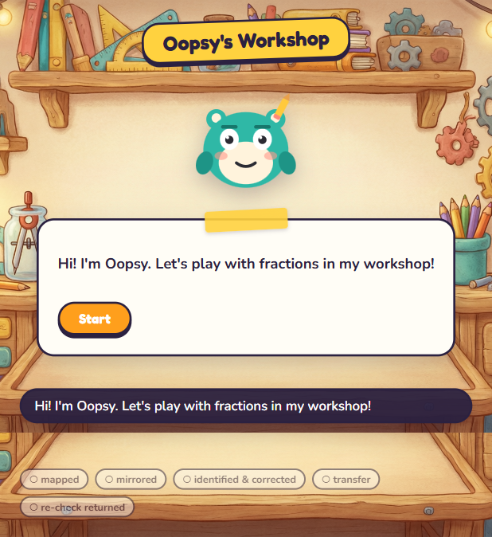
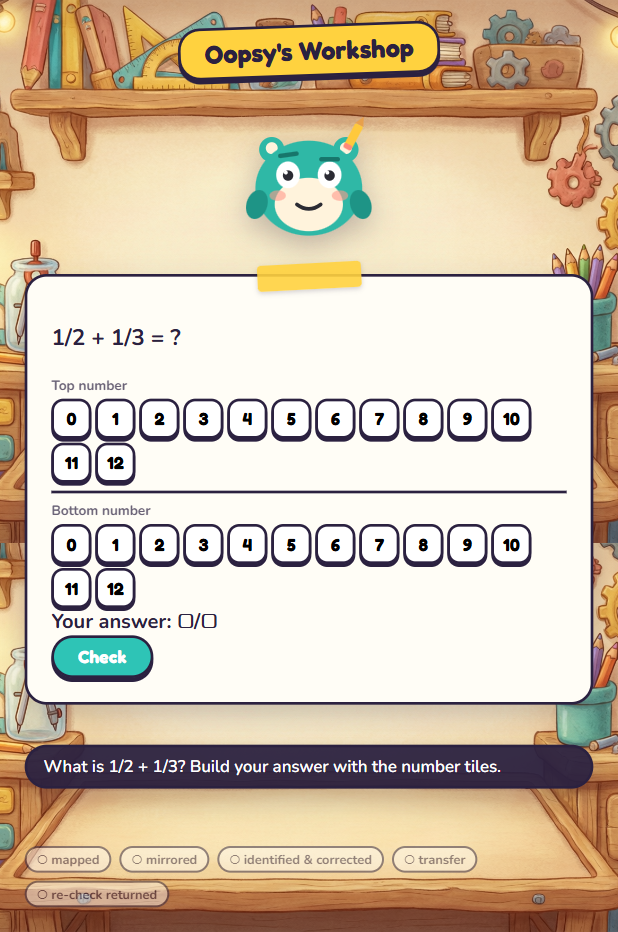
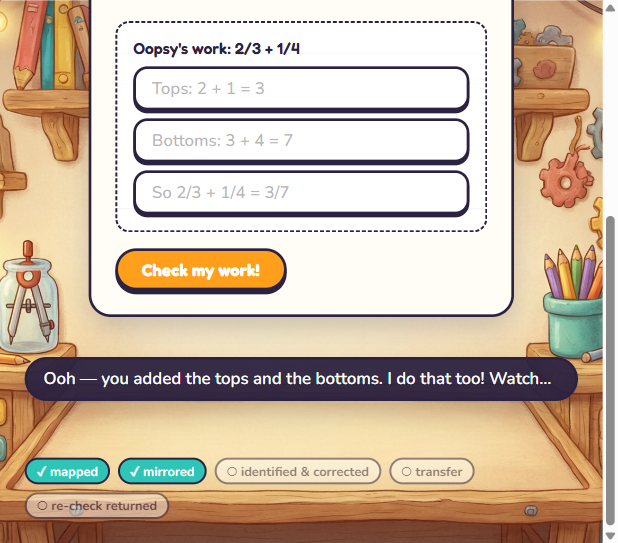
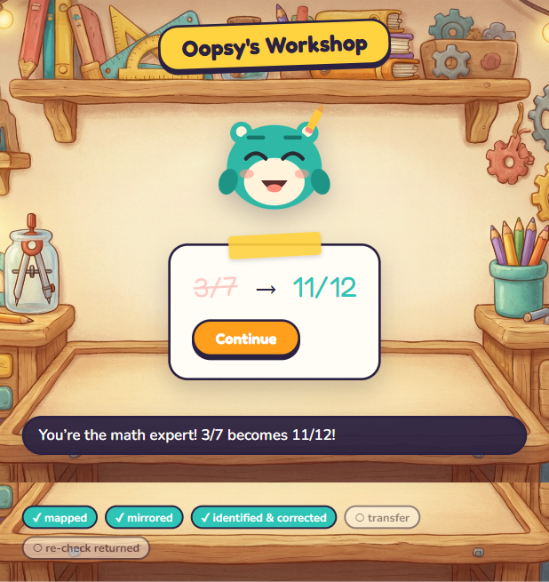
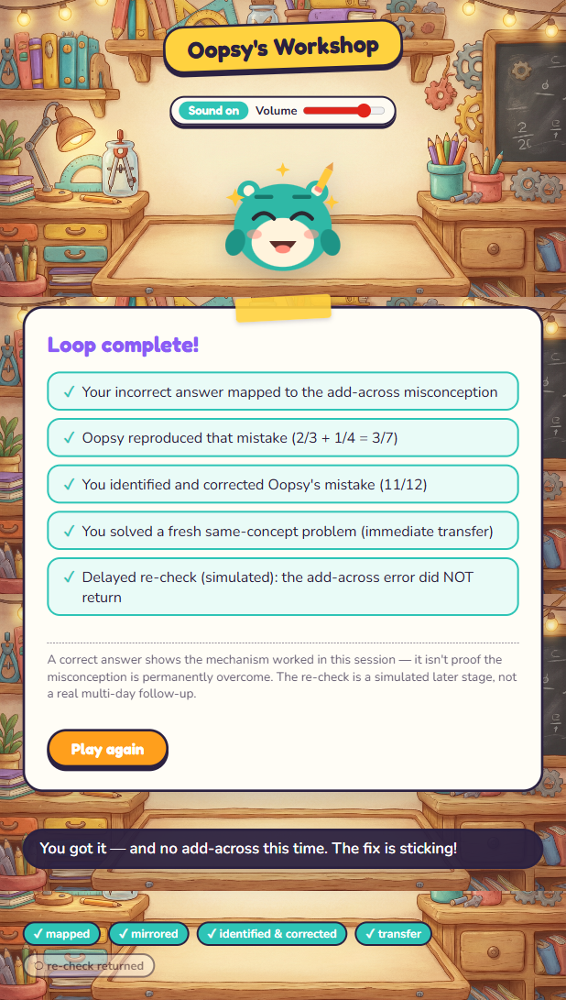

# Oopsy's Workshop

A character-driven fraction-learning proof of concept for ages 10–14. Instead of being
told they're wrong, the child **catches Oopsy's mistake and teaches the fix**.

Everything is **deterministic and client-side**: no AI calls at runtime, no accounts, no
persistence. Oopsy's voice is pre-generated with [Piper](https://github.com/rhasspy/piper)
(asset-time only), and every spoken line has a caption, so the whole loop is playable with
sound off.

**Live demo:** <https://oopsy-phi.vercel.app>

## Screenshots

| The Workshop opens | The diagnostic |
| --- | --- |
|  |  |
| Oopsy greets you; the five success criteria sit along the bottom. | Build `1/2 + 1/3` with number tiles. |

| Oopsy mirrors the mistake | Oopsy repairs its own work |
| --- | --- |
|  |  |
| Oopsy reproduces the add-across error and invites you to check its work. | After you teach the fix, `3/7` becomes `11/12`. |


*The Wrap summary records all five success criteria for the session.*

## The core loop

1. **Diagnose** — the child answers `1/2 + 1/3` using number tiles.
2. **Mirror** — a wrong answer (e.g. `2/5`) maps deterministically to the classic
   *add-across* misconception; Oopsy reproduces that same mistake on a fresh problem.
3. **Identify** — the child taps the wrong step in Oopsy's worked solution.
4. **Teach & rebuild** — the child picks the correcting principle, then rebuilds the
   equivalent fractions with bounded number tiles.
5. **Repair** — Oopsy erases and repairs its own solution.
6. **Transfer & re-check** — a fresh same-concept problem, then a simulated delayed
   re-check to see whether the misconception returns.
7. **Wrap** — a summary records all five success criteria.

## Getting started

```bash
npm install
npm run dev
```

Open the printed URL (default `http://localhost:5173`).

### The intended demo path

1. On the diagnostic, answer **2/5** (the classic add-across mistake) to trigger Oopsy's
   mirrored solution. Answering **5/6** shows the correct-first-answer branch instead.
2. Tap Oopsy's wrong step to identify it.
3. Pick the correct principle, then fill the rebuild blanks (`8`, `3`, `11`).
4. Watch Oopsy erase and repair `3/7 → 11/12`.
5. Complete the transfer problem and the delayed re-check.
6. Review the Wrap summary.

Use the sound toggle (top right) to play with voice + SFX on or muted; captions always
mirror the spoken lines.

## Project layout

- `src/loop/` — the guarded step machine and session state
- `src/engine/` — fraction math and deterministic misconception detection
- `src/content/` — authored problems, solutions, and voice lines
- `src/components/` — UI panels, number tiles, and the Oopsy character
- `src/audio/` — voice + SFX playback
- `public/` — art, audio assets, favicon
- `tools/` — Python generators for voice and SFX
- `devpost/` — planning artifacts and the app map

## Project docs

The planning artifacts travel with the repo under `devpost/`:

- `scope.md` — the proof-of-concept boundary and the unique kernel
- `prd.md` — behaviors, states, and acceptance criteria
- `spec.md` — the technical blueprint (components, data model, file structure)
- `checklist.md` — the build slices and their verification record
- `app-map.html` — a visual map of the finished code (open in a browser)

## Tech stack

- React 18 + TypeScript + Vite 5
- Framer Motion 11 (animations, honoring `prefers-reduced-motion`)
- Vitest 2 (engine, detection, loop, content, and audio-asset tests)
- Piper TTS + procedurally generated SFX as build-time asset tools (Python)

## Tests and build

```bash
npm run test       # Vitest suite (engine, detection, loop, content, audio assets)
npm run typecheck  # tsc --noEmit
npm run build      # production build into dist/
npm run preview    # serve the production build locally
```

## Regenerating audio assets (optional)

Voice and SFX are committed under `public/audio/` and only need regenerating if
`src/content/lines.ts` changes. The `audio-assets` test fails if a voice key has no
matching file.

```bash
python -m venv .venv
.venv\Scripts\pip install piper-tts          # Windows
python -m piper.download_voices en_US-amy-medium --data-dir tools/piper-models
.venv\Scripts\python tools/gen_voice.py        # writes public/audio/voice/...
.venv\Scripts\python tools/gen_sfx.py          # writes public/audio/sfx/...
```

